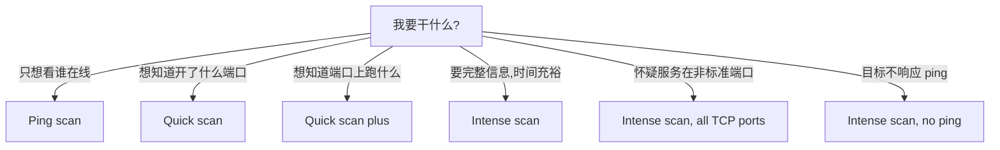

# 01 · Zenmap 图形界面入门

> **本章目标**：先建立「目标 → 配置 → 命令 → 结果」这条链路的心智模型。
>
> **一句话提醒**：Zenmap 只是 Nmap 的外壳，它最终执行的还是命令行。**学会看 Command 框里自动生成的那条命令，比记住按钮位置更有价值。**

## 1.1 Zenmap 是什么

Zenmap 是 Nmap 官方提供的跨平台图形前端（Windows / Linux / macOS）。它把你的点击翻译成 `nmap` 命令，再把文本输出整理成表格、拓扑图和主机详情。

| 维度 | 说明 |
| --- | --- |
| 能做 | 可视化选择目标与配置、自动生成命令、汇总端口表、画网络拓扑、保存/比较历史扫描 |
| 不能做 | 它**不新增任何扫描能力**；命令行走不通的，Zenmap 也走不通 |
| 维护状态 | Zenmap 随 Nmap 一同发布（官方安装包内置），界面的独立更新明显滞后于命令行。新版 Nmap 的部分参数在 Zenmap 的配置项里可能找不到——遇到这种情况直接在 Command 框里手写参数 |
| 适用阶段 | 初学建立直觉、向非技术同事演示、快速对比两次扫描结果 |

**学习建议**：前两周用 Zenmap，但**每次点 `Scan` 之前先看 Command 框**，把它抄到笔记里自己用命令行跑一遍。两周后就应该以命令行为主——只有命令行能自动化、能写进脚本、能精确控制每一个参数。

## 1.2 界面四大区域

Zenmap 主窗口可以切成四块。下面这张"地图"值得先记住，后文所有小节都按它展开。

| 区域 | 位置 | 作用 | 对应命令行概念 |
| --- | --- | --- | --- |
| 操作选项区 | 顶部 | Target / Profile / Command / Scan | `nmap [选项] <目标>` |
| 信息窗口 | 中部 | Nmap Output / Ports·Hosts / Topology / Host Details / Scans | 标准输出、`-oN`、`-oX` |
| 菜单栏 | 最顶 | Scan / Tools / Profile / Help | 保存、比较、过滤、自定义配置 |
| 状态/进度 | 底部 | 扫描进度、耗时、错误提示 | `-v`、`-d` 输出的摘要 |

## 1.3 操作选项区

### 1.3.1 Target（扫描目标）

用于指定扫描目标，可以填 IP、域名、网段、IP 范围，**多个目标之间用空格或逗号分隔**。

| 你输入 | 含义 |
| --- | --- |
| `192.0.2.10` | 单个主机 |
| `192.0.2.0/24` | 一个 /24 网段（254 个可用地址） |
| `192.0.2.10-20` | 一个闭区间地址范围（11 个地址） |
| `192.0.2.10 example.com` | 两个不同目标 |
| `-iL targets.txt` | 从文件读目标（在 Command 框里用） |

> `<目标IP>`、`<目标网段>` 等占位符的含义见 [README 占位符约定](../README.md#占位符约定)。

### 1.3.2 Profile（扫描配置）

Profile 是"一组参数的打包"。选中一个 Profile，Command 框里的命令会**立刻被替换**成该配置对应的命令。内置 10 种，详见 [1.4](#14-内置-10-种扫描配置)。

**这是初学者最容易踩的坑**：你手写了一条命令，再去下拉框里点了一下 Profile，手写的命令就没了。想保留手写命令，就别动 Profile。

### 1.3.3 Command（扫描命令）

输入格式：

```bash
nmap [扫描类型] [选项/参数] <目标>
```

| 部分 | 是否必需 | 说明 |
| --- | --- | --- |
| `nmap` | 必需 | 程序名。Zenmap 的 Command 框里可以省掉，但建议写上，方便复制到终端 |
| `[扫描类型] [选项/参数]` | 可选 | 决定"怎么扫"。不写则按默认常规扫描（TCP 连接扫描 + 常见端口） |
| `<目标>` | 必需 | 扫描目标。缺了它 Nmap 会直接打印用法并退出 |

### 1.3.4 Scan（开始扫描）

点击后按当前 Command 执行。想中止，用菜单 `Scan → Stop`（对应命令行 `Ctrl+C`）。

---

#### 命令

```bash
nmap 192.0.2.10
```

#### 适用场景

确认 Zenmap 装好了、Nmap 能跑，目标是**你自己的**机器或授权范围内的主机。这是全书最短的一次扫描。

#### 示例

在 Target 框填 `192.0.2.10`，Profile 选 `Regular scan`，Command 框会显示类似 `nmap 192.0.2.10`，点 Scan。

#### 示例输出

【自测留白】在你自己的环境里跑一次，把真实输出贴到下面。要记录的内容：对 `scanme.nmap.org`（Nmap 官方允许扫描的公开测试目标）或本地靶场执行默认扫描的完整文本输出，
用来展示"Nmap scan report / PORT / STATE / SERVICE / Nmap done"这五段的结构。**注意：真实扫描输出若要入仓，必须先脱敏并注明扫描环境与时间。**

#### 结果判读

默认扫描会给出三块信息：

1. **扫描头部**：`Starting Nmap <版本> ( https://nmap.org ) at <时间>` —— 版本与开始时间。
2. **每台主机一段**：`Nmap scan report for <目标IP>` + `Host is up (...)` + 端口表。
3. **结尾**：`Nmap done: 1 IP address (1 host up) scanned in <秒数>`。

`Host is up (0.00042s latency)` 里的延迟是**探测包往返时间**，不是 ping 的 RTT，局域网内通常是零点几毫秒。

#### 注意事项

- 直接 `nmap <目标>` 不带任何参数时，Nmap 默认扫**常见 1000 个 TCP 端口**（不是 65535），且用**全连接扫描** `-sT`（因为最不需要权限）。
- 想扫全部端口必须显式写 `-p-`，见[第 04 章](04-port-scan.md)。

#### 下一步决策

| 你看到的 | 下一步 |
| --- | --- |
| 端口一大片 `open` | 进 [05 章](05-service-os.md)，用 `-sV` 问"跑的是什么" |
| 全是 `filtered` | 进 [09 章](09-troubleshooting.md) 排查防火墙，或试 `-Pn` |
| `Host seems down` | 换 `-Pn` 再看一次 |
| 扫得特别慢 | 换 `-T4` 或 `-F`，见 [07 章](07-speed-evasion-output.md) |

## 1.4 内置 10 种扫描配置

下面这张表是全章最该背下来的部分。第三列是**近似等价命令**，用于理解 Profile 到底做了什么；实际生成结果以 Command 框显示为准。

| # | Profile | 用途 | 近似等价命令 | 耗时 | 侵入性 |
| --- | --- | --- | --- | --- | --- |
| 1 | Intense scan | 全面扫描：版本 + 系统 + 脚本 + 路由 | `-T4 -A -v` | 中 | 中 |
| 2 | Intense scan plus UDP | 上者再加 UDP | `-sS -sU -T4 -A -v` | 高 | 中 |
| 3 | Intense scan, all TCP ports | 全 TCP 端口 + 全面探测 | `-p 1-65535 -T4 -A -v` | 很高 | 中 |
| 4 | Intense scan, no ping | 假设主机全存活，跳过探活 | `-T4 -A -v -Pn` | 高 | 中 |
| 5 | Ping scan | 只做主机发现，不扫端口 | `-sn` | 低 | 低 |
| 6 | Quick scan | 快速扫常见 100 端口 | `-T4 -F` | 低 | 低 |
| 7 | Quick scan plus | 快速扫 + 版本 + 系统 | `-sV -T4 -O -F --version-light` | 中 | 中 |
| 8 | Quick traceroute | 只做路由追踪 | `-sn --traceroute` | 低 | 低 |
| 9 | Regular scan | 什么都不加，纯默认 | （无参数） | 低 | 低 |
| 10 | Slow comprehensive scan | 慢速但尽量全面，含大量发现探测 | 见下方说明 | 很高 | 中高 |

> **关于第 10 项**：Slow comprehensive scan 会组合多种主机发现探测与 `default or (discovery and safe)` 脚本集，
> 命令很长且随版本可能变化，此处不逐字复写；在你所用版本里选中该 Profile，直接复制 Command 框里的内容核对，
> 比抄书上的字符串可靠。

### 结果判读：怎么选 Profile



### 注意事项

- `Intense scan, all TCP ports` 对单个公网目标可能跑几十分钟，对 /24 网段就是灾难。**先用 Quick scan 探路**。
- `Intense scan plus UDP` 的 UDP 部分极慢（UDP 无连接，Nmap 要等超时或收 ICMP 不可达），且容易触发告警。
- Profile 只是"起点"，不是"答案"。真正常用的组合在 [08 章](08-workflow.md)。

## 1.5 信息窗口（五个标签页）

五个标签页都在主窗口中部的信息窗口里，按当前要回答的问题选一个看即可。

### 1.5.1 Nmap Output（原始文本输出）

就是命令行里会看到的那段文字，**原封不动**。这是最该盯的地方：

- 出问题时错误信息在这里；
- 复制给别人复现问题时，给的也是这一段；
- 用 `-oN` 保存下来的文件内容与此相同。

### 1.5.2 Ports / Hosts（端口与主机汇总表）

把多台主机的端口拉到一张表里，列的含义：

| 列 | 含义 | 怎么读 |
| --- | --- | --- |
| `Port` | 端口号 | 与 `Protocol` 一起构成唯一定位 |
| `Protocol` | `tcp` / `udp` | 同一个端口号在 TCP 与 UDP 上是两个不同服务 |
| `State` | 端口状态 | **本书最重要的概念**，六种状态见 [04 章](04-port-scan.md#41-六种端口状态) |
| `Service` | 服务类型 | Nmap 按端口号 + 指纹猜的服务名，不是定论 |
| `Version` | 版本 | 只有跑了 `-sV` 才有内容；`unknown` 表示探测失败 |

> 原笔记在这里只列了 `open` / `closed` / `filtered` 三种。完整的六种状态（含 `unfiltered`、`open|filtered`、
> `closed|filtered`）在 [04 章 4.1](04-port-scan.md#41-六种端口状态) 统一讲，因为那是端口扫描的核心概念，放在 GUI 章节里讲不透。

### 1.5.3 Topology（网络拓扑）

拓扑页把扫描到的网络关系画成图。三个控件决定你看到什么：

| 控件 | 作用 |
| --- | --- |
| Hosts viewer | 列出扫描到的所有主机与节点，可点击定位 |
| Fisheye | 鱼眼视图，把复杂网络"压扁"到一屏，用于看整体形状 |
| Controls | 调整布局算法、显示哪些元素、是否显示路由节点 |

拓扑图的连线来自 `--traceroute`（`-A` 会隐含开启）。**没跑 traceroute 就没有连线**——这是初学者常见的困惑来源。

### 1.5.4 Host Details（单台主机详情）

把一台主机在原始输出里散落各处的内容汇总成一页：主机名、IP、状态、端口、操作系统、脚本结果、路由跳数。

**用途**：写报告时按主机抄信息最方便。但注意——它是"汇总视图"，脚本输出的细节仍要回 Nmap Output 里看原文。

### 1.5.5 Scans（扫描历史）

记录本次会话里跑过的每一次扫描。

| 列 | 含义 |
| --- | --- |
| Status | 完成 / 中断 / 出错 |
| Command | 这次跑的命令（**复盘时最有价值的一列**） |

双击历史条目可以回到那次扫描的结果。**关掉 Zenmap 后历史默认不保留**，要留证据必须 `Scan → Save Scan`。

## 1.6 菜单栏

菜单栏四组：Scan 管扫描与保存，Tools 管扫完之后的分析，Profile 管配置，Help 管查手册。前两组最常用。

### 1.6.1 Scan 菜单

发起、保存、关闭都在这组里：

| 菜单项 | 作用 | 命令行等价 |
| --- | --- | --- |
| New Window | 新建扫描窗口，并行跑多个扫描 | — |
| Open Scan | 打开以前保存的 `.xml` 结果 | 读 `-oX` 的产物 |
| Open Scan in This Window | 在当前窗口打开（替换现有结果） | — |
| Save Scan | 保存当前结果 | `-oX` |
| Save All Scans to Directory | 批量保存所有扫描结果到目录 | 每个扫描各自 `-oA` |
| Print | 打印 | — |
| Close Window | 关闭当前窗口 | — |
| Quit | 退出程序 | — |

> **实用技巧**：`Save All Scans to Directory` 是 Zenmap 少数比命令行舒服的功能——一次课做了十几次扫描，一键全存成 XML，事后慢慢比对。

### 1.6.2 Tools 菜单

这组解决"扫完之后怎么用这批结果"：

| 菜单项 | 作用 | 典型用法 |
| --- | --- | --- |
| Compare Results | 比较两次扫描，高亮差异 | 打补丁前后对比、端口变化监控 |
| Search Scan Results | 在结果里搜主机/端口/服务 | 一次扫了 /24，只想找开着 3389 的机器 |
| Filter Hosts | 按规则过滤主机列表 | 只看 Linux、只看开了 80 的 |

**Compare Results 是被严重低估的功能。** 变更前后各扫一次，比一眼能看出"多开了 8080"——这比重扫一遍再人工对比可靠得多。

### 1.6.3 Profile 菜单

只有两项，用来把一串参数固化成可复用的配置：

| 菜单项 | 作用 |
| --- | --- |
| New Profile or Command | 自定义一组参数并存成新 Profile |
| Edit Selected Profile | 编辑已有 Profile（可改参数、可改脚本集） |

自定义 Profile 的本质就是给一条长命令起个名字。**建议命名带用途**，例如 `web-only-sV`，不要用 `mytest1`、`test2`。

### 1.6.4 Help 菜单

平时用不到，出问题时有三个入口：

| 菜单项 | 作用 |
| --- | --- |
| Help | 打开 Zenmap 与 Nmap 的官方手册 |
| Report a Bug | 跳转官方 Issue 跟踪页 |
| About | 显示版本与致谢信息 |

## 1.7 Zenmap 与命令行怎么选

按场合区分：

| 场景 | 建议 |
| --- | --- |
| 第一次接触 Nmap，想看清结果结构 | Zenmap |
| 要给非技术同事演示扫描过程 | Zenmap |
| 对比两次扫描差异 | Zenmap 的 Compare Results |
| 需要精确控制参数、要可复现 | 命令行 |
| 要写进脚本、跑定时任务、处理 100+ 目标 | 命令行 |
| 需要保存原始证据用于报告 | 命令行 + `-oA`（比 GUI 保存更可控） |

**结论**：Zenmap 用来"看懂"，命令行用来"干活"。真正的工作流在 [08 章](08-workflow.md)，全部是命令行。

## 本章初学者检查清单

- [ ] 能说出 Zenmap 的 Command 框与 `nmap` 命令行的关系（谁翻译谁）
- [ ] 不看笔记能写出 `nmap [扫描类型] [选项] <目标>` 的三段结构，并说出哪段可省
- [ ] 能从 10 个内置 Profile 中挑出「只想看谁在线」和「怀疑服务在非标准端口」各该用哪个
- [ ] 知道 `Ports/Hosts` 表里 `Service` 是"猜的"、`Version` 只有 `-sV` 才有
- [ ] 能解释为什么拓扑图有时没有连线
- [ ] 知道 Zenmap 关闭后扫描历史不会自动保留，要手动 Save

## 本章修改说明

1. 原文按"界面区域 → 菜单项"平铺罗列，缺少「为什么要在意这个界面」。本章改为每个区域先给一句定位，再讲细节。
2. 原文未提 Zenmap 与命令行的能力边界与取舍，补充 [1.7](#17-zenmap-与命令行怎么选)，明确"GUI 看懂、命令行干活"。
3. 原文 10 种 Profile 只有中文描述，无对应参数。本章补充**近似**等价命令列，并标注"以 Command 框实际显示为准"，避免被当成标准答案。
4. 原文 `Ports/Hosts` 的 state 只列 3 种。本章不在此展开，改为指向 [04 章](04-port-scan.md) 的统一六状态定义，避免同一概念在两章形成两套说法。
5. 原文全部 16 张图均为第三方图床外链。本章**不收录截图**：界面类内容改用「区域 → 作用 → 对应命令行概念」表格描述，
   读者可对照自己打开的 Zenmap 核对。这样仓库不会因图床失效变成一堆破图，也避免截图里残留真实 IP / 主机名。
