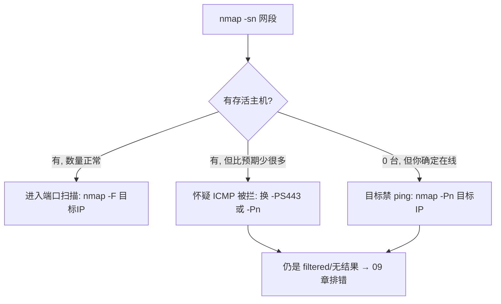

# 03 · 主机发现：先确认谁在线

> **本章目标**：搞清楚 Nmap 在"扫端口"之前到底偷偷发了什么包，以及为什么你会看到 `Host seems down`。

## 3.1 为什么需要主机发现

Nmap 的默认流程是两步：

```text
① 主机发现（host discovery）→ 这台机器活着吗？
② 端口扫描（port scan）    → 它开了哪些端口？
```

第二步比第一步慢一个数量级。如果对着一整个 /16 网段直接扫端口，99% 的时间会浪费在不存在的地址上。所以 Nmap 默认**先探活、再只扫活的主机**。

理解这一点的关键推论：

> **当主机发现失败时，端口扫描根本不会开始。** 你看到的 `Host seems down` 不是"端口全关"，而是"我没确认它活着，所以不扫了"。

## 3.2 默认的主机发现做了什么

不带任何发现参数时，Nmap 对**本地网段**和**远程网段**用不同策略：

| 目标位置 | 默认探测组合 | 说明 |
| --- | --- | --- |
| 同网段（局域网） | ARP 请求 + ICMP + TCP | ARP 最快最可靠，有它就够 |
| 跨网段（路由可达） | ICMP echo + TCP SYN 到 80/443 + TCP ACK 到 80 + ICMP timestamp | 任一有回应即判定存活 |

**关键认知**：只要**任意一种**探测得到回应，主机就被判定为 `up`。所以"ping 不通但 Nmap 说 Host is up"是正常的——它可能回应了 TCP SYN。

## 3.3 `-sn`：只探活，不扫端口

### 命令

```bash
nmap -sn <目标网段>
```

### 适用场景

- 刚拿到一个网段，想知道里面有哪些机器；
- 做资产盘点第一轮；
- 想快速判断"目标到底还在不在"。

### 示例

```bash
nmap -sn 192.0.2.0/24
```

### 示例输出

【待补充示例输出】建议补充：一个至少 3 台主机在线的 `/24` 网段 `-sn` 输出，需要能看出「每台主机两行（`Nmap scan report for ...` + `Host is up
(...)`)」「没有 PORT 表」「结尾 `Nmap done: 256 IP addresses (3 hosts up) scanned in ...`」这三个特征。

输出形态大致是：

```text
Starting Nmap <版本> ( https://nmap.org ) at <时间>
Nmap scan report for 192.0.2.10
Host is up (0.00042s latency).
Nmap scan report for 192.0.2.11
Host is up (0.00051s latency).
Nmap done: 256 IP addresses (2 hosts up) scanned in <秒> seconds
```

> 上面这段只展示**结构**（行序、字段名、缩进），不包含任何实际测量数据。真实输出请自行在靶场生成后替换。

### 结果判读

| 你看到 | 含义 | 下一步 |
| --- | --- | --- |
| 有 `Nmap scan report for` + `Host is up` | 该地址存活 | 加入待扫清单 |
| 该地址完全没出现 | 没回应任何探测包 | 可能不存在、可能防火墙静默丢弃、可能禁 ICMP |
| 结尾 `(0 hosts up)` 但你确定目标在线 | 探测方式被拦 | 换 `-Pn` 或 `-PS` |
| `Host is up (0.00042s latency)` | 延迟很低 | 大概率同网段或同一机房 |

**注意**：`-sn` 的输出里**没有端口信息**。如果你看到端口表，说明你的 Nmap 版本或命令写错了（比如把 `-sn` 写成了 `-sN`，那是 NULL 扫描，不是主机发现）。

### 注意事项

- `-sn` 全称是 "no port scan"。在旧版本里叫 `-sP`，现在仍可用但已不推荐。
- `-sn` 对**本地网段**靠 ARP，几乎 100% 准确；对**跨网段**靠 ICMP/TCP，容易被防火墙影响。
- 权限：`-sn` 的 ICMP/TCP SYN 部分需要原始套接字（root/管理员）。非 root 下 Nmap 会退化为 TCP connect 探测，准确性下降但不报错。

### 下一步决策



## 3.4 `-Pn`：跳过主机发现

### 命令

```bash
nmap -Pn <目标IP>
```

### 适用场景

- 明确知道目标在线（比如你刚 ssh 上去过、或它是你自己的服务器）；
- 目标禁 ICMP，`-sn` 扫不出来；
- 目标在防火墙后面，所有发现探测都被静默丢弃。

### 示例

```bash
# 已知主机存活，直接扫端口
nmap -Pn -F 192.0.2.10
```

### 示例输出

【待补充示例输出】建议补充：同一台禁 ICMP 的靶机，先用 `-sn` 得到 `Host seems down`、再用 `-Pn -F` 得到端口表的**对照输出**。这是全章最有说服力的一组证据。

### 结果判读

加 `-Pn` 后：

- **所有目标都会被当作存活**，因此**每台都会真的被扫端口**；
- 报告里不再有 `Host is up (...)` 这一行（因为没有做探测），直接给端口表；
- 结尾统计的 `hosts up` 数会**等于目标数**——这个数字此时没有意义，别拿它当"存活数"。

### 注意事项

> [!WARNING]
> `-Pn` 会关闭 Nmap 唯一的"省流量"机制。对一个大网段用 `-Pn`，等于对每个地址都发完整的端口扫描包，**耗时和流量成倍增长，且极易触发 IDS**。

| 场景 | 是否该用 `-Pn` |
| --- | --- |
| 单个已知存活主机 | 该用 |
| 一台机器禁 ping | 该用 |
| 跨网段 + 大范围 | 不该用，先试 `-PS` |
| 想统计"存活主机数" | 不该用，数字会失真 |

### 下一步决策

| 情况 | 下一步 |
| --- | --- |
| `-Pn` 后端口全是 `filtered` | 目标可能真被防火墙全挡，或你的出口被封。进 [09 章](09-troubleshooting.md) |
| `-Pn` 后扫出端口 | 正常，继续 `-sV` |
| `-Pn` 扫得极慢 | 缩小端口范围：`-Pn -p 22,80,443` 而不是 `-Pn -p-` |

## 3.5 `-PS<端口>`：用 TCP SYN 探活

### 命令

```bash
nmap -PS<端口列表> <目标IP>
```

### 适用场景

目标禁 ICMP（`-sn` 扫不出来），但**大概率开着某个 TCP 端口**——比如 Web 服务器一定开 443。用它做探活，绕过"只拦 ICMP"的防火墙。

### 示例

```bash
# 用 Web 端口探活
nmap -PS80,443 192.0.2.10

# 探活 + 扫常用端口
nmap -PS443 -F 192.0.2.10
```

### 示例输出

【待补充示例输出】建议补充：一台"禁 ICMP 但开 443"的靶机，分别用 `-sn`（失败）、`-PS443`（判定 up）的对照输出，
说明 `Host is up` 后括号里的探测来源标识（不同版本可能显示 `Host is up (0.0012s latency).`，无来源标识）。

### 结果判读

判定逻辑：

| 目标回应 | Nmap 判定 | 底层原因 |
| --- | --- | --- |
| `SYN/ACK` | up | 端口开着 |
| `RST` | up | 端口关着，但主机活着 |
| 无回应 | down / 继续试其他探测 | 被静默丢弃 |

**关键点：`RST` 也算存活证据。** 很多人误以为"端口关了就等于主机不在"，其实"有人回 RST"恰恰证明主机在。

### 注意事项

- 端口选**目标上一定存在的服务**：Web 站选 443 或 80，SSH 服务器选 22。随便选一个高位端口大概率没回应。
- `-PS` 需要原始套接字权限（root/管理员）。非 root 时会退化为 `-PA`（TCP ACK）语义或直接失败【待核实：不同版本退化行为不同，以 `nmap --help` 与实际输出为准】。
- 一次可以给多个端口：`-PS22,80,443`，但端口越多越慢、越显眼。
- 默认端口是 80（只写 `-PS` 不带数字时）。

### 下一步决策

| 情况 | 下一步 |
| --- | --- |
| `-PS` 判定 up | 继续端口扫描 |
| `-PS` 仍判定 down | 换 `-Pn` 硬扫，或视为真的不在线 |
| 目标开放的是 UDP 服务 | 换 `-PU`（见下表）或 `-Pn` |

## 3.6 `-PR`：ARP 扫描（仅局域网）

### 命令

```bash
nmap -PR <目标网段>
```

### 适用场景

目标与你在**同一个二层网络**（同 VLAN、同交换机、同 Wi-Fi）。这是局域网内最可靠的探活方式。

### 示例

```bash
nmap -sn -PR 192.168.1.0/24
```

### 示例输出

【待补充示例输出】建议补充：同一网段下 `-sn`（默认含 ARP）与 `-sn -PR` 的输出，说明二者结果通常一致——因为在本地网段上 `-sn` 本来就优先用 ARP。

### 结果判读

ARP 是二层协议，**目标无法在不"装死"的情况下不回应**（除非它有严格的 ARP 防护或主机防火墙拦 ARP）。所以：

| 现象 | 含义 |
| --- | --- |
| ARP 有回应 | 主机 100% 在线，即使它禁了所有 ICMP 和 TCP |
| ARP 无回应 | 大概率真的不在线（或不在同一广播域） |

### 注意事项

| 限制 | 说明 |
| --- | --- |
| 只在本地网段有效 | 跨路由时 ARP 不会转发，`-PR` 自动失效，Nmap 会回退到其他探测 |
| 需要 root/管理员 | 原始套接字 |
| 会暴露你的 MAC | ARP 是明文广播，交换机的 MAC 表、ARP 监控能看到你 |
| 不能穿透防火墙策略 | 有 ARP 防护（如动态 ARP 检测 DAI）的网络里可能被拦 |

### 下一步决策

| 情况 | 下一步 |
| --- | --- |
| ARP 扫出一堆设备 | 先按 `-F` 快速看端口，再挑重点做 `-sV` |
| 想区分设备类型 | 用 `-O` 或看 MAC 厂商前缀（OUI） |
| 扫不到但确定在线 | 检查是否跨了 VLAN 或目标在容器网络里 |

## 3.7 发现探测方式对照

Nmap 的发现探测不止原文列出的四种。完整清单如下，供你在"某一种被拦"时横向替换：

| 参数 | 协议 | 判定依据 | 权限 | 典型用途 |
| --- | --- | --- | --- | --- |
| `-PR` | ARP | ARP 回应 | root | 本地网段，最可靠 |
| `-PE` | ICMP echo | Echo Reply | root | 最传统，最容易被拦 |
| `-PP` | ICMP timestamp | Timestamp Reply | root | 老式防火墙可能放行 |
| `-PM` | ICMP netmask | Address Mask Reply | root | 更老，命中率低 |
| `-PS<端口>` | TCP SYN | SYN/ACK 或 RST | root | 绕过"只拦 ICMP" |
| `-PA<端口>` | TCP ACK | RST | root | 绕过只拦 SYN 的无状态防火墙 |
| `-PU<端口>` | UDP | ICMP 端口不可达 | root | 目标只开 UDP 时 |
| `-PY<端口>` | SCTP INIT | INIT-ACK 或 ABORT | root | SCTP 环境，少见 |
| `-PO<协议>` | IP 协议 | ICMP 协议不可达 | root | 冷门协议探测 |
| `-Pn` | 无 | 假定全存活 | 无 | 放弃探活，直接扫 |

**实战顺序**：`-sn` → 没结果就 `-PS443` → 还没结果就 `-Pn`。三步都不行，问题通常不在探测方式上，而在链路或策略上，进 [09 章](09-troubleshooting.md)。

## 3.8 `-sn` 与"扫端口"的关系（常见误解）

| 你敲的命令 | 实际行为 | 会不会扫端口 |
| --- | --- | --- |
| `nmap -sn <目标>` | 只做发现 | 不会 |
| `nmap -sN <目标>` | **NULL 扫描**（不是主机发现！） | 会 |
| `nmap -Pn <目标>` | 跳过发现 + 扫默认 1000 端口 | 会 |
| `nmap -sn -Pn <目标>` | 参数冲突，`-Pn` 被忽略 | 不会 |
| `nmap -sn -p 80 <目标>` | 端口参数被忽略 | 不会 |

最后两行值得记住：**`-sn` 一旦出现，端口相关参数全部失效**。

## 本章初学者检查清单

- [ ] 能解释为什么 `Host seems down` 不等于"端口全关"
- [ ] 能说出本地网段与跨网段时，默认发现探测方式的差别
- [ ] 知道 `-Pn` 会让 `hosts up` 统计数字失真
- [ ] 能说明为什么目标回 `RST` 也证明它存活
- [ ] 会按 `-sn → -PS443 → -Pn` 的顺序逐级替换
- [ ] 知道 `-sn` 与 `-sN` 完全不是一回事

## 本章修改说明

1. 原文把 `-sn` / `-Pn` / `-PS` / `-PR` 列为四个并列词条，未解释"Nmap 默认就在做主机发现"。本章补充 3.2 节说明默认探测策略，这是理解后续所有现象的前提。
2. 原文 `-PS<端口> <IP>` 的语法易被读成"必须给端口"，本章明确"只写 `-PS` 时默认用 80"。
3. 原文未提 `RST` 也是存活证据，导致初学者误判"端口关了 = 主机不在"。补充 3.5 结果判读表。
4. 原文摘要里 `-PS` 的说明有笔误（"绕过紧 ICMP 的防火墙"），本章改写为通顺表述并补全"为什么选 Web 端口"。
5. 补充 3.7 发现探测对照表与 3.8 `-sn`/`-sN` 混淆提示，这两处是初学者高频出错点。
6. 原文示例地址 `192.168.44.25` 替换为 `192.0.2.10`，属于脱敏处理，不改变语义。
