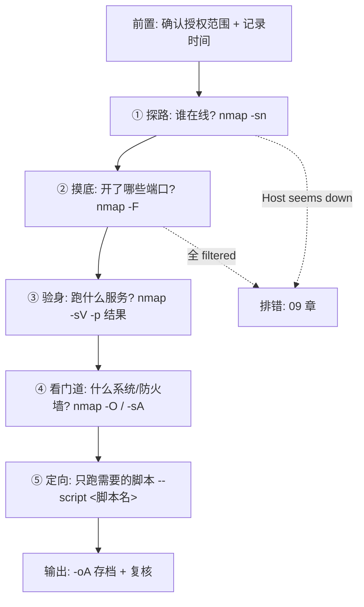

# 08 · 五阶段实战工作流

> **本章目标**：把前面七章的参数串成一条能照着走的路径。
>
> 这一章不需要背命令，需要记住的是**每个阶段"该问什么问题"**，以及**结果不符合预期时往哪个方向换命令**。

## 8.1 全景图



**顺序不能乱**，原因是成本：

| 阶段 | 单主机耗时量级 | 为什么必须在前一阶段之后 |
| --- | --- | --- |
| ① 主机发现 | 毫秒~秒 | — |
| ② 端口扫描（1000 端口） | 秒~分钟 | 先排除不在线的主机，省 90% 时间 |
| ③ 版本探测 | 每个开放端口数秒 | 只对已确认开放的端口做 |
| ④ 系统识别 | 十几秒~分钟 | 需要③的结果做交叉验证 |
| ⑤ 脚本 | 几秒~几分钟/脚本 | 需要③知道跑哪个脚本 |

**最常见的效率错误**：上来就 `nmap -A -p- <网段>`。它把五个阶段糊在一起，慢十倍、噪音十倍、结果还没法分段复核。

## 8.2 第零步：开扫之前

这一步不是技术动作，但**跳过它的人后来都后悔**。

| 检查项 | 具体做法 |
| --- | --- |
| 授权范围 | 书面确认哪些 IP/域名/端口在范围内，哪些明确排除 |
| 时间窗口 | 约定可扫描的时段（避开业务高峰与备份窗口） |
| 速率约定 | 约定最大速率，或对方提供的白名单出口 IP |
| 联系人 | 出问题时找谁、电话多少（服务挂了要能立刻通知） |
| 记录 | 记下开始时间、命令、自己的出口 IP |
| 排除清单 | 写入 `exclude.txt`，用 `--excludefile` |

完整的合规要求见 [10 章](10-legal-and-safety.md)。

## 8.3 阶段一：探路 —— 谁在线

### 命令

```bash
nmap -sn <目标网段>
```

### 适用场景

刚拿到一个网段，不知道里面有什么。

### 示例

```bash
nmap -sn -T4 -n --min-rate 500 192.0.2.0/24 -oA 01-discovery-192.0.2.0-24
```

### 示例输出

【自测留白】在你自己的环境里跑一次，把真实输出贴到下面。要记录的内容：一个 `/24` 网段的完整 `-sn` 输出，用于展示"每台主机两行、无端口表、结尾统计"的形态。

### 结果判读

只关心两件事：

1. **哪些地址出现了** → 存活清单；
2. **结尾 `(N hosts up)`** → 与你的预期是否相符。

不关心端口（这一步根本没扫端口）。

### 注意事项

- 对公网目标，`-sn` 的可靠性明显低于内网（ICMP 常被拦）。
- `-n` 关掉反向解析能显著提速；需要主机名时事后单独查。

### 下一步决策

| 情况 | 判断 | 换什么命令 |
| --- | --- | --- |
| A. 扫出一堆存活主机 | 正常 | 进入阶段二：`nmap -F <目标IP>` |
| B. 明知道某台在线，但 `-sn` 没扫出来（`Host seems down`） | 目标禁 ping | `nmap -Pn <目标IP>` |
| C. 跨网段，怀疑 ICMP 被防火墙拦 | 只有 ICMP 被拦 | `nmap -PS443 <目标IP>`（用 Web 端口探活） |
| D. 一台都没有，且是公网段 | 可能整段被保护 | **停下**，先确认授权与目标是否还活着，不要盲目加 `-Pn` 扫全段 |

## 8.4 阶段二：摸底 —— 开了哪些端口

### 命令

```bash
nmap -F <目标IP>
```

### 适用场景

确认主机在线后，快速看它暴露了哪些服务入口。

### 示例

```bash
nmap -F -T4 -n 192.0.2.10 -oA 02-ports-192.0.2.10
```

### 示例输出

【自测留白】在你自己的环境里跑一次，把真实输出贴到下面。要记录的内容：一台典型 Web 服务器的 `-F` 输出（含 1–3 个 open 端口 + `Not shown` 统计行），用于说明"输出行数远少于 100"。

### 结果判读

三个关键信号：

| 信号 | 含义 | 重要性 |
| --- | --- | --- |
| `Not shown: N closed tcp ports (reset)` | 其余端口关闭且回 RST | **说明没有防火墙拦你** |
| `Not shown: N filtered tcp ports (no-response)` | 其余端口无响应 | **说明有防火墙/丢包** |
| 只有 1–2 个 open | 可能服务在非标准端口 | 需要 `-p-` |

### 注意事项

- `-F` 只扫 100 个端口，**漏报是设计特性，不是 bug**。
- 出口 IP 可能被目标封了，表现为"第二次扫描结果突然全 filtered"。

### 下一步决策

| 情况 | 判断 | 换什么命令 |
| --- | --- | --- |
| A. 多个常规端口 open | 正常 | 进入阶段三：`nmap -sV -p <端口列表> <目标IP>` |
| B. 只有一两个端口，目标很重要 | 怀疑服务藏在高位端口 | `nmap -Pn -p- -T4 --min-rate 1000 <目标IP>`（**单机才这么做**） |
| C. 全 `filtered` | 被拦 | 见 [09 章](09-troubleshooting.md) |
| D. 怀疑有 UDP 服务（DNS/SNMP/NTP） | 端口扫描看不见 UDP | `nmap -sU --top-ports 50 <目标IP>` |

## 8.5 阶段三：验身 —— 跑的是什么

### 命令

```bash
nmap -sV -p <端口列表> <目标IP>
```

### 适用场景

知道哪些端口开着，想知道具体软件与版本。

### 示例

```bash
nmap -sV -p 22,80,443 192.0.2.10 -oA 03-version-192.0.2.10
```

### 示例输出

【自测留白】在你自己的环境里跑一次，把真实输出贴到下面。要记录的内容：`-sV` 输出中 `VERSION` 列与 `Service Info` 行的对应关系，以及一个 `unknown` 的实际例子。

### 结果判读

| 现象 | 含义 | 可信度 |
| --- | --- | --- |
| 产品名 + 版本都清楚 | 指纹匹配成功 | 高 |
| 只有产品名 | 版本没抓到 | 中 |
| `unknown` | 没匹配上 | 无 |
| 服务名带 `?` | 猜测 | 低 |

### 注意事项

- **只扫已发现的端口**。`-sV -p-` 是性能灾难。
- 版本号可能被反代/WAF 改写。

### 下一步决策

| 情况 | 判断 | 换什么命令 |
| --- | --- | --- |
| A. 版本清晰 | 可以进入后续分析 | 进入阶段四或阶段五 |
| B. `unknown` / 明显错乱 | 指纹不足 | `nmap -sV --version-all -p <端口> <目标IP>` |
| C. 服务跑在非标准端口且没识别出 | Nmap 跳过了该端口的完整探测 | `nmap -sV --allports -p <端口> <目标IP>` |

## 8.6 阶段四：看门道 —— 什么系统、什么防火墙

### 命令

```bash
nmap -O <目标IP>
```

### 适用场景

需要判断目标系统类型，或想弄清"端口为什么是 filtered"。

### 示例

```bash
nmap -O -p 22,80,443,1 192.0.2.10
```

（故意加 `-p 1`，因为 `-O` 需要一个大概率关闭的端口来做指纹。）

### 示例输出

【自测留白】在你自己的环境里跑一次，把真实输出贴到下面。要记录的内容：一段 `OS details` / `Aggressive OS guesses` 的真实输出，以及一段 `No exact OS matches` 的失败输出。

### 结果判读

| 现象 | 含义 |
| --- | --- |
| `OS details: ...` | 明确匹配 |
| `Aggressive OS guesses: ... (95%)` | 猜测 + 置信度 |
| `No exact OS matches` | 未识别 |
| 完全没有 OS 段 | 条件不满足（缺 open/closed 配对）或权限不足 |

### 注意事项

- `-O` 需要 root，且**极易被 IDS 标记**。
- 云主机、容器环境识别率低，属正常。

### 下一步决策

| 情况 | 判断 | 换什么命令 |
| --- | --- | --- |
| A. 识别模糊，全是低置信度 | 需要更多候选 | `nmap -O --osscan-guess <目标IP>` |
| B. 很多端口 `filtered`，想知道防火墙怎么设 | 需要区分"被拦"与"端口关" | `nmap -sA -p <端口列表> <目标IP>` |
| C. 识别不出但服务版本清楚 | 从服务版本反推系统 | 不必强求 `-O` |
| D. 只是想减少 `-O` 的时间 | 只对有条件的主机做 | `nmap -O --osscan-limit <目标网段>` |

**关于 B 的判读**：`-sA` 给出 `unfiltered` 只说明**包能到达主机**，不说明端口开放。它回答的是"防火墙挡不挡"，不是"服务在不在"。

## 8.7 阶段五：定向 —— 只跑需要的脚本

### 命令

```bash
nmap -sV -sC -p <端口列表> <目标IP>
```

### 适用场景

基础信息齐了，想在 Web、SMB、SSH 这些具体服务上多拿一点信息。

### 示例

```bash
# 先跑默认安全脚本
nmap -sV -sC -p 22,80,443 192.0.2.10 -oA 04-default-scripts-192.0.2.10

# 再按需精确点名
nmap -p 80,443 --script http-title,http-headers,ssl-cert 192.0.2.10
```

### 示例输出

【自测留白】在你自己的环境里跑一次，把真实输出贴到下面。要记录的内容：`-sC` 脚本段的完整输出，至少含一条单行 `|_` 与一条多行 `|`，用于说明两种行首标记的差别。

### 结果判读

脚本输出按 `|` 缩进分组，`|_` 标记该脚本输出的结束。详见 [06 章 6.2.1](06-nse.md#621--sc运行默认脚本集)。

### 注意事项

> [!WARNING]
> 阶段五之后**最容易越界**。看到 `VULNERABLE`、看到 `/admin/`、看到匿名 FTP 可写，都是**线索**，不是"可以继续验证"的许可。
>
> 任何进一步的验证（登录、上传、利用）都需要**新的、明确的授权**。本书到此为止。

### 下一步决策

| 情况 | 判断 | 换什么命令 |
| --- | --- | --- |
| A. 发现 Web 服务，想知道有没有隐藏路径 | 需要目录枚举（**会发大量请求**） | `nmap -p <端口> --script http-enum <目标IP>`，先确认授权与限速 |
| B. 发现 SMB 端口，想知道系统信息 | 需要 SMB 枚举 | `nmap -p 445 --script smb-os-discovery,smb-enum-shares <目标IP>`（`enum-shares` 属中风险） |
| C. 发现 FTP，想确认匿名登录 | 只查"是否允许"，不下载 | `nmap -p 21 --script ftp-anon <目标IP>` |
| D. 想试弱口令 / 验漏洞 | **超出本书范围** | **停**。需单独书面授权，仅限隔离靶场。见 [06 章 6.6](06-nse.md#66-脚本类别与风险分级) |

## 8.8 综合推演（模板化）

下面是一段**结构化的推演模板**，展示"敲什么 → 期望看到什么 → 为什么换命令"。所有地址为文档保留地址，输出为**结构描述而非实测结果**。

> 场景：你是某公司的网管，被要求排查 `192.0.2.0/24` 这段自有办公网里有哪些设备暴露了服务。

### 第 1 步

```bash
nmap -sn 192.0.2.0/24 -oA 01-discovery
```

**期望**：列出多台存活主机，其中 `192.0.2.10` 是一台用途不明的设备。

**此时该想的事**：存活数量是否与资产台账对得上？多出来的那台是什么？

### 第 2 步

```bash
nmap -F 192.0.2.10 -oA 02-ports
```

**可能遇到**：

- 提示 `Host seems down` → 刚才还在线，现在扫不到 → **换 `nmap -Pn -F 192.0.2.10`**（跳过探活）；
- 全部 `filtered` → **换 `nmap -Pn --reason -F 192.0.2.10`** 看 REASON 列，确认是被 DROP 还是网络不通。

**期望**：`<端口1>/tcp open`、`<端口2>/tcp open`。

### 第 3 步

```bash
nmap -sV -sC -p <端口1>,<端口2> 192.0.2.10 -oA 03-service
```

**期望**：

- `VERSION` 列给出 Web 服务与 SSH 的产品与版本；
- 脚本段出现 `|_http-title: <页面标题>`（例：某内部测试系统的登录页标题）；
- 可能出现 `| ssl-cert:` 多行证书信息。

**此时该想的事**：这台设备是"应该出现在办公网里的"吗？它的服务是业务需要，还是临时搭的？

### 第 4 步（仅在授权明确允许目录枚举时）

```bash
nmap -p <端口1> --script http-enum 192.0.2.10 -oA 04-enum
```

**期望**：脚本返回若干 `|_ /path/: 描述` 行。

**此时该做的事**：**记录，不深入。** 把发现的路径清单交给资产负责人确认，而不是自己去点开看。

### 第 5 步

```bash
nmap -sV -sC -p <端口1>,<端口2> -oA 05-final 192.0.2.10
```

**目的**：把"最终确认的信息"单独存一份，作为报告附件。注意这一步与前一步的差别只是**重新取一次完整快照并命名**，方便报告引用。

### 复盘：这段流程的真正价值

| 你练到的能力 | 对应章节 |
| --- | --- |
| 命令失败时会换命令，而不是重跑同一条 | [03](03-host-discovery.md) / [09](09-troubleshooting.md) |
| 看 `Not shown` 行判断有无防火墙 | [04](04-port-scan.md) / [07](07-speed-evasion-output.md) |
| 只对已发现端口做深挖，不盲目 `-p-` | [04](04-port-scan.md) |
| 脚本输出会被正确分组阅读 | [06](06-nse.md) |
| 每一步都有 `-oA` 存档，可复核 | [07](07-speed-evasion-output.md) |
| 知道在哪里停下 | [10](10-legal-and-safety.md) |

## 8.9 一页速查

```bash
# ① 探路
nmap -sn -T4 -n <目标网段> -oA 01-discovery

# ② 摸底（单机）
nmap -F -T4 -n <目标IP> -oA 02-ports

# ②' 摸底（全端口，仅单机）
nmap -Pn -p- -T4 --min-rate 1000 <目标IP> -oA 02-ports-all

# ③ 验身
nmap -sV -p <端口列表> <目标IP> -oA 03-service

# ④ 系统与防火墙
nmap -O -p <端口列表>,1 <目标IP>
nmap -sA -p <端口列表> <目标IP>

# ⑤ 定向脚本（低风险优先）
nmap -sV -sC -p <端口列表> <目标IP> -oA 04-scripts
nmap -p <端口> --script <脚本名> <目标IP>

# 排错
nmap -Pn --reason -v -p <端口> <目标IP>
```

## 本章初学者检查清单

- [ ] 能说出五个阶段各自回答什么问题，以及为什么顺序不能乱
- [ ] 拿到 `Host seems down` 时，第一反应是换 `-Pn` 而不是重跑
- [ ] 会用 `Not shown:` 那一行判断有没有防火墙
- [ ] 知道 `-p-` 只能对单机用
- [ ] 在阶段五之后能主动停下，把线索交给人工确认
- [ ] 每次扫描都带 `-oA`，文件名含日期与用途

## 本章修改说明

1. 原文第三、四部分是两个独立清单（"常见搭配指令" + "综合实战推演示例"）。本章把二者合并为一条连续路径，推演部分改为"每步给出可能的意外 + 对应换什么命令"，这才符合"教学笔记"而不是"命令列表"的定位。
2. 补充 8.2「开扫之前」的六项检查（授权、时间窗、速率、联系人、记录、排除清单），原文完全没有这一步，而它是实战中唯一能防止事故的环节。
3. 原文阶段三示例含 `Apache httpd 2.4.49`、`OpenSSH 8.2p1` 等具体版本号。本章改为 `<产品名> <版本>` 占位符，避免被误读为实测或"标准答案"。
4. 原文阶段五含"试数据库/FTP 弱口令"与"验证 MS17-010"两条流程。本章按合规要求改为 `ftp-anon`（只查是否允许匿名，不下载）与"停在线索、交人工确认"，并在 D 行明确标注"超出本书范围"。
5. 新增 8.1 的成本表格（各阶段耗时量级），用于解释"为什么不能上来就 `-A -p-`"。
6. 原文示例 IP `192.168.122.0/24`、`192.168.44.25` 等统一替换为 `192.0.2.0/24`、`192.0.2.10`。
