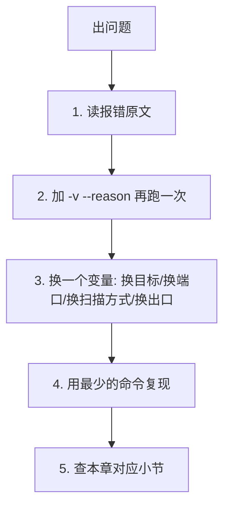

# 09 · 常见报错与排错

> **本章目标**：把"报错了"变成"知道往哪查"。
>
> 排错的第一原则：**先看 Nmap 自己说了什么。** 绝大多数问题的答案就在那几行英文里，只是初学者习惯性跳过。

## 9.0 排错通用顺序



具体做法：

| 步骤 | 命令 |
| --- | --- |
| 看详细信息 | `nmap -v --reason <原命令去掉部分参数>` |
| 看内部决策 | `nmap -d2 -p <单个端口> <目标IP>` |
| 换最小复现 | 只留一个目标、一个端口，去掉所有 `-o*` 与脚本 |
| 验证连通性 | `ping`、`nc -vz <目标IP> <端口>`、`curl -v` |

## 9.1 权限不足

### 现象

```text
You requested a scan type which requires root privileges.
QUITTING!
```

或者（Windows）：

```text
dnet: Failed to open device eth0
```

或者扫描能跑，但 Nmap 提示：

```text
TCP connect() scan from a non-privileged user
```

### 原因

`-sS`、`-O`、`-sA`、`-sN/-sF/-sX`、`-sU`、`-PR`、`-D`、`-S` 都需要**原始套接字**（raw socket）权限，因为要自己构造并发送原始数据包。

| 平台 | 需要的权限 |
| --- | --- |
| Linux / macOS | `root`，或给 `nmap` 二进制加 `CAP_NET_RAW` capability |
| Windows | 以管理员身份运行；需要安装 **Npcap**（WinPcap 已过时） |

### 解决

```bash
# Linux：直接用 sudo
sudo nmap -sS -p 80,443 192.0.2.10

# Linux：不给 root 也能跑原始扫描（推荐，比每次 sudo 安全）
sudo setcap cap_net_raw,cap_net_admin,cap_net_bind_service+eip "$(which nmap)"
nmap -sS -p 80,443 192.0.2.10
```

> [!WARNING]
> `setcap` 之后，**任何本地用户都能用 nmap 发原始包**。这在多用户机器上是提权面（nmap 的历史漏洞多在脚本引擎与 `--interactive`）。个人靶场机可以，生产/办公机不要这么做。

### 不想提权怎么办

| 原命令 | 无特权替代 | 代价 |
| --- | --- | --- |
| `-sS` | `-sT` | 慢、日志多 |
| `-O` | 无替代 | 只能从服务版本反推系统 |
| `-sU` | 无替代 | UDP 扫描必须原始套接字 |
| `-sA` | 无替代 | — |

### Windows 特有

- 未安装 Npcap：安装 Nmap 官方包时**勾选 Npcap**，或单独装 Npcap。
- 安装了但报 `Failed to open device`：检查是否有其他抓包软件（Wireshark 的旧版 WinPcap）冲突，卸载旧驱动。
- 管理员权限：右键"以管理员身份运行"。

## 9.2 Host seems down（明明在线却扫不到）

### 现象

```text
Note: Host seems down. If it is really up, but blocking our ping probes, try -Pn
Nmap done: 1 IP address (0 hosts up) scanned in <秒> seconds
```

### 原因

五种可能，按概率排序：

| # | 原因 | 判断依据 |
| --- | --- | --- |
| 1 | 目标/中间防火墙丢弃了 ICMP 与探测 TCP 包 | 你能 `curl`/`ssh` 上去，但 `nmap` 说 down |
| 2 | 目标只允许特定源 IP 访问 | 换个出口（VPN/跳板）就通了 |
| 3 | 你扫错了地址（DNS 解析到别处、IP 写错） | `dig`/`nslookup` 核对 |
| 4 | 目标在 NAT 后，没有端口映射 | 内网地址从外网必然不可达 |
| 5 | 目标真不在线 | `ping` 也无响应 |

### 解决顺序

```bash
# ① 确认目标真的可达（用你平时访问它的方式）
curl -I --max-time 5 http://192.0.2.10/     # 或 ssh、telnet、浏览器

# ② 换 TCP 探活
nmap -PS443 -p 443 192.0.2.10

# ③ 最后一招：跳过探活，直接扫
nmap -Pn -p 80,443 192.0.2.10
```

### 注意

- `-Pn` 不是"修复"，是"放弃探活"。它会让**不存在的 IP 也被扫一遍**，耗时可能翻几十倍。
- 加了 `-Pn` 后**所有端口都是 `filtered`**，说明包发出去了但没回来——问题在链路上，不在探活方式上。进 [9.6](#96-被防火墙与-ids-拦截)。

## 9.3 DNS 解析失败

### 现象

```text
Failed to resolve "example.internal"...
WARNING: No targets were specified, so 0 hosts scanned.
```

或者：

```text
nmap: unrecognized option ... (当你把域名和参数写反了)
```

### 原因

| # | 原因 | 检查方法 |
| --- | --- | --- |
| 1 | 域名确实不存在 / 拼错 | `dig <域名>` |
| 2 | 内网域名，本机 DNS 不知道 | `dig @<DNS服务器IP> <域名>` |
| 3 | 本机 `/etc/resolv.conf` 被 VPN 改坏 | `cat /etc/resolv.conf` |
| 4 | 目标的 A 记录只有 IPv6（AAAA） | `dig AAAA <域名>`；需加 `-6` |
| 5 | 中间 DNS 污染 | 换可信 DNS 对比结果 |

### 解决

```bash
# ① 先确认解析
dig +short example.com
nslookup example.com

# ② 指定 DNS 服务器给 nmap
nmap -F --dns-servers 192.0.2.53 example.com

# ③ 或者自己解析后用 IP 扫（最稳）
IP=$(dig +short example.com | head -1)
nmap -F "$IP"
```

### 注意

- `--dns-servers` 只影响 Nmap 自己的解析，不改系统设置。
- 内网域名**必须用内网 DNS**。用公共 DNS 查内网名字必然失败，而且会把你的目标清单泄漏给第三方。
- 解析出多个 IP 时，Nmap 默认只扫第一个。要全扫需自己解析后传入。

## 9.4 扫描太慢

### 现象

`-p-` 跑了半小时还没结束；`-sU` 几乎不动；网段扫描卡在某台主机上。

### 定位

| 场景 | 主因 | 验证 |
| --- | --- | --- |
| `-p-` 全端口慢 | 端口多 + 默认重试 3 次 | 加 `-T4` 后是否明显变快 |
| `-sU` 慢 | UDP 靠超时判定，重试多 | 加 `--max-retries 1` 后是否变快 |
| 网段扫描卡住 | 某台主机无响应，Nmap 在等超时 | `-v` 看当前扫到哪台 |
| 所有扫描都慢 | 链路丢包 / 出口限速 | `ping` 看丢包率 |
| 突然变慢 | 被目标限速或封禁 | 换目标试，或隔一段时间再试 |

### 优化组合

```bash
# 单机全端口：可控时长
nmap -Pn -p- -T4 --min-rate 1000 --max-retries 1 --stats-every 10s 192.0.2.10

# UDP：只扫最常用的
nmap -sU --top-ports 50 --max-retries 1 --host-timeout 3m 192.0.2.10

# 网段：跳过慢主机 + 关 DNS
nmap -sn -T4 -n --min-rate 500 192.0.2.0/24
```

### 注意

> [!WARNING]
> 提速的代价是**准确度**。`-T5` + `--max-retries 0` 会让慢服务被误判为 `filtered`。
>
> 判断方法：用 `-T4` 和 `-T2` 各扫一次同一批端口，如果结果不一致，**以慢的那次为准**，并把这批端口单独复核。

## 9.5 结果全是 filtered

### 现象

整张端口表清一色 `filtered`，或者 `Not shown: 1000 filtered tcp ports (no-response)`。

### 为什么这很严重

`filtered` 只说明"没收到回应"。四种完全不同的原因都会产生它，而**处理方式完全不同**：

| 原因 | 特征 | 处理 |
| --- | --- | --- |
| 目标防火墙 DROP | 只有部分端口 filtered | 正常现象，记录即可 |
| 目标 IPS 主动封锁了你 | **扫描中途**从 open 变 filtered | 立刻停止，降速，换出口 |
| 你的出口网络拦截 | 所有目标所有端口都 filtered | 换出口（VPN/跳板），或找网络组开白名单 |
| 目标不存在（配合 `-Pn`） | 整段全 filtered，且延迟异常 | 确认目标是否还在线 |

### 定位四步

```bash
# ① 看 REASON 列：是被 DROP 还是网络不可达
nmap -Pn --reason -p 80,443 192.0.2.10
```

| REASON | 含义 | 方向 |
| --- | --- | --- |
| `no-response` | 包发出去了，没人理 | 目标侧 DROP，或链路丢包 |
| `host-unreachable` | ICMP 主机不可达 | 目标不存在 / 路由问题 |
| `net-unreachable` | ICMP 网络不可达 | 路由/网段问题 |
| `admin-prohibited` | ICMP 管理员禁止 | 明确被策略拦 |

```bash
# ② 用 ACK 扫描区分"能不能到达主机"
nmap -sA -p 80,443 192.0.2.10
```

`-sA` 得到 `unfiltered` → 包能到主机，只是 SYN 被拦（说明主机活着、防火墙在工作）。
`-sA` 也是 `filtered` → 连 ACK 都到不了，问题在更外层。

```bash
# ③ 用你平时的访问方式验证端口是否真的可用
curl -I --max-time 5 https://192.0.2.10/
nc -vz 192.0.2.10 443
```

```bash
# ④ 换一个已知可达的目标做对照
nmap -Pn -p 443 203.0.113.10    # 如果这个也 filtered，问题在你的出口
```

### 常见误判

> **`filtered` ≠ "端口关闭"。**
> **`filtered` ≠ "没有服务"。**
> 报告里写"该端口已关闭"是错的，应写"该端口无响应，疑似被过滤"。

## 9.6 被防火墙与 IDS 拦截

### 现象

- 扫描开始时正常，**中途**突然全部 `filtered`；
- 只有你的 IP 被拦，同事的机器正常；
- Web 服务返回 403 / 429 / 验证码页；
- 后续所有 `curl` 都超时。

### 怎么确认是"你被封了"

| 检查 | 方法 |
| --- | --- |
| 换目标 | 扫另一台不相关的主机，如果正常 → 是目标封了你 |
| 换出口 | 换 VPN/跳板后正常 → 是你的出口 IP 被封 |
| 看时间相关性 | 封禁通常在**扫描开始后 10 秒~2 分钟**内发生 |
| 看响应变化 | 从 `syn-ack` 变成 `no-response`，且不再恢复 |

### 处置

```text
① 立即停止扫描。继续扫只会延长封禁时间、扩大封禁范围。
② 记录：被封时间、被封前最后一条正常结果、你的出口 IP。
③ 通知授权方：说明情况，请求解封或加入白名单。
④ 恢复后降速：-T2 或 --max-rate 50，并缩小端口范围。
```

### 为什么"绕过"通常不是好选择

| 想法 | 现实 |
| --- | --- |
| 换 `-D` 诱饵 | 有状态防火墙不认；且可能牵连无关第三方 IP |
| 伪造源 IP `-S` | 收不到回包，扫描直接失效 |
| 分片 `-f` | 现代设备重组后照样拦 |
| 加 `--data-length` | 检测看的是行为模式，不是单包长度 |
| 换 `-T1` 慢慢扫 | 低频长时扫描在 IDS 里更可疑 |

**真正有效的手段是流程性的**：授权方加白名单、约定扫描窗口、降低速率、分批次小范围扫。这些都需要**人去沟通**，不是参数能解决的。

> [!WARNING]
> 在客户环境中被 IDS 拦下后**继续尝试绕过**，在很多合同里属于违约，在部分司法辖区属于"规避安全措施"的加重情节。正确做法是停下来联系对方。

## 9.7 脚本相关报错

| 报错 | 原因 | 处理 |
| --- | --- | --- |
| `ERROR: Script execution failed` | 脚本与目标服务版本不兼容 | 换脚本；不是目标问题 |
| `SCRIPT ENGINE: Script is not available` | 脚本名拼错，或脚本库缺失 | `--script-help <脚本名>` 确认；必要时 `--script-updatedb` |
| 脚本无任何输出 | 端口未被识别为对应服务 | 先 `-sV` 确认协议 |
| 脚本卡住不返回 | 目标响应极慢或被半开拦截 | `--script-timeout 30s` |
| `Namespace prefix ... not bound` | 脚本自身 XML/库问题 | 更新 Nmap 或换脚本 |
| `Lua error` | 脚本代码错误 | 记录脚本名与版本，向 Nmap 官方报 issue |

**通用排查**：`--script-trace` 能看到脚本实际发了什么包、收到什么。如果它连包都没发，说明脚本没被触发（端口/协议不匹配）。

## 9.8 其他常见问题

| 现象 | 原因 | 处理 |
| --- | --- | --- |
| `WARNING: No targets were specified` | 目标参数丢了（常见于 `-iL` 文件为空） | 检查文件路径与内容 |
| `Failed to open output file` | 目录不存在或无写权限 | 先建目录；`-oA out/scan` 要求 `out/` 存在 |
| 输出里出现 `Nmap scan report for` 但没有端口表 | 该主机只做了发现，没扫端口（`-sn` 或全部超时） | 正常，视命令而定 |
| 同一目标两次扫描结果不同 | 负载均衡 / CDN 不同节点 / 目标服务重启 | 记录两次结果，注明环境；不要取"更好的那个" |
| 扫自己本机也 filtered | 本机防火墙（Windows Defender 防火墙 / iptables）拦了 | 先关本机防火墙或用 `127.0.0.1` |
| Windows 下 `-sS` 报错 | 需要 Npcap + 管理员 | 装 Npcap，管理员运行 |
| 扫描结果里全是 `closed` 没有 `open` | 端口选错 / 服务没起 / 扫的是错误 IP | 用 `curl` 手工验证一个端口 |
| `-p` 报 `Invalid port number` | 端口 > 65535 或写成了 `80-` | 检查区间写法 |
| 中文路径/文件名报错 | 编码问题 | 输出文件名用 ASCII |

## 9.9 排错决策速查

| 症状 | 第一反应 | 第二反应 |
| --- | --- | --- |
| 报权限错误 | 加 `sudo` | 换 `-sT` |
| `Host seems down` | 加 `-Pn` | `-PS443` |
| 域名解析失败 | `dig` 手工验证 | `--dns-servers <DNS服务器IP>` |
| 太慢 | `-T4 --min-rate` | 缩小端口范围 |
| 全 `filtered` | `--reason` 看原因 | `-sA` 区分"被拦"与"不可达" |
| 中途全 `filtered` | **停** | 联系授权方 |
| 脚本无输出 | `-sV` 确认协议 | `--script-help` |
| 结果与预期不符 | 换一种扫描方式对照 | 以更慢、更保守的那次为准 |

## 本章初学者检查清单

- [ ] 遇到报错时，先读英文原文，而不是立刻改参数
- [ ] 知道哪些扫描需要 root，以及无 root 时的替代方案
- [ ] 会用 `-Pn` / `-PS443` / `curl` 三种方式验证"目标到底在不在"
- [ ] 能说出 `filtered` 的四种成因，并且不会把它写成"端口关闭"
- [ ] 扫到一半全变 `filtered` 时，第一反应是停止而不是绕过
- [ ] 会用 `--reason` 的 REASON 列区分"被 DROP"与"不可达"

## 本章修改说明

1. 本章为**完全新增**章节。原笔记没有任何排错内容，但"照着敲命令然后卡住"是初学者最主要的流失点。
2. `Host seems down` 一节给出五种成因与"三命令定位法"，并强调 `-Pn` 是"放弃探活"而非"修复"。
3. "结果全 filtered"一节的核心是四因判别表与 REASON 列判读——这是把模糊症状变成可执行动作的关键。
4. "被防火墙/IDS 拦截"一节**明确反对**绕过，并逐条说明 `-D`/`-S`/`-f`/`--data-length`/`-T1` 为何无效。这既是技术要求，也是合规要求。
5. 所有示例地址使用 `192.0.2.x` / `203.0.113.x` 文档保留段；`setcap` 方案附带了"多用户机器的提权面"警告。
6. 9.8 收录了 9 条高频小问题（含 Windows/Npcap、中文路径、两次结果不一致），这些在原笔记与多数教程里都缺。
